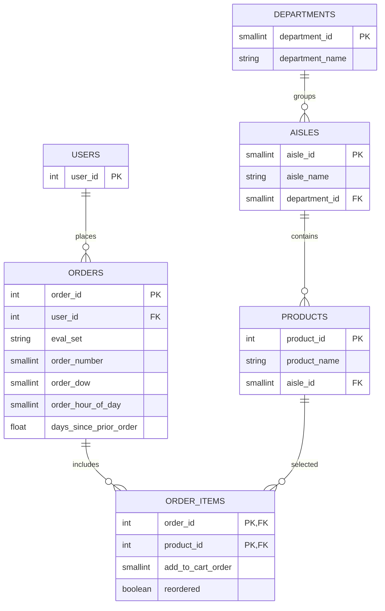

# Архитектура и ETL

## Контур обработки

1. Определяется источник: каталог или ZIP. ZIP проверяется по CRC, для каждого
   из шести CSV проверяются заголовок и SHA-256. Fingerprint вычисляется из
   отсортированной карты `имя файла → SHA-256`, поэтому ZIP и распакованный
   каталог с теми же байтами имеют общий идентификатор.
2. DuckDB читает исходники с явными типами, строгим разбором CSV и заданным
   лимитом памяти. Проверяются ключи, диапазоны, связи и последовательности.
3. После предварительных проверок PostgreSQL регистрирует попытку импорта.
   Справочники копируются первыми. `department_id` переносится из `products.csv`
   в `core.aisles` только после проверки, что у каждой товарной группы ровно одно
   подразделение.
4. Заказы копируются потоком во временную staging-таблицу. Уникальные покупатели
   формируются из `orders.csv`; строки `prior` и `train` объединяются в
   `core.order_items`. У заказов `test` позиций нет.
5. Замена содержимого `core` и финальная проверка находятся в одной транзакции.
   При ошибке PostgreSQL откатывает замену целиком. Статус `failed` записывается
   отдельным соединением после отката. Сессионная advisory-блокировка запрещает
   параллельную загрузку.
6. При повторном fingerprint без `--force` текущие таблицы не меняются. С
   `--force` пересборка выполняется явно; предыдущие данные остаются доступны,
   пока новая транзакция не завершится успешно.

Крупные файлы копируются блоками по 1 МиБ, без чтения всего CSV в память.
DuckDB выгружает временные данные на настроенный диск при достижении лимита.

## ER-диаграмма

`ops.ingestion_runs` содержит fingerprint, временные метки, статус, количества,
результаты проверки и текст ошибки. Если набор невозможно обнаружить, fingerprint
остаётся `NULL`, а попытка фиксируется как ошибка этапа обнаружения. `mart` создана миграцией для последующей
аналитической реализации и пока пуста.

## Границы и гарантии

- Ошибки типов, ключей или связей прекращают обработку; автоматическая очистка
  и молчаливый пропуск строк не выполняются.
- Позиции тестовых заказов неизвестны в исходной поставке. Они не создаются.
- Инварианты проверяются для датасета любого размера. Контрольные количества
  полного исходного набора показываются отдельно и не ограничивают фикстуры.
- Локальный запуск на 8 ГБ RAM ограничен настройками DuckDB и потоковой передачей
  CSV, но скорость и свободное дисковое пространство зависят от машины.
