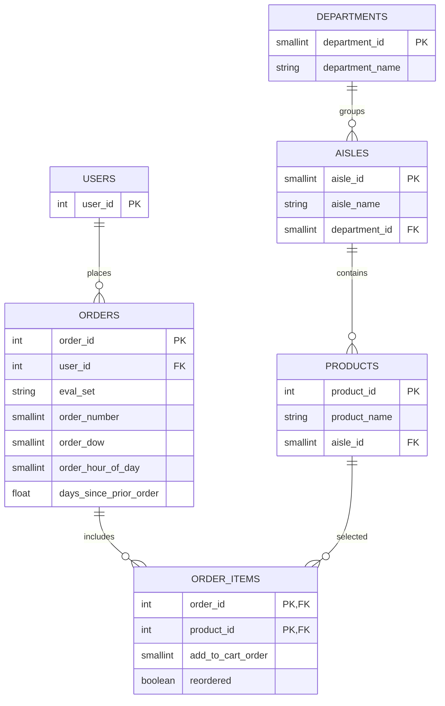

# Архитектура и ETL

## Контур обработки

1. Определяется источник: каталог или ZIP. ZIP проверяется по CRC, для каждого
   из шести CSV проверяются заголовок и SHA-256. Fingerprint вычисляется из
   отсортированной карты `имя файла → SHA-256`, поэтому ZIP и распакованный
   каталог с теми же байтами имеют общий идентификатор.
2. DuckDB читает исходники с явными типами, строгим разбором CSV и заданным
   лимитом памяти. Проверяются ключи, диапазоны, связи и последовательности.
3. После предварительных проверок PostgreSQL регистрирует попытку импорта.
   Справочники копируются первыми. `department_id` переносится из `products.csv`
   в `core.aisles` только после проверки, что у каждой товарной группы ровно одно
   подразделение.
4. Заказы копируются потоком во временную staging-таблицу. Уникальные покупатели
   формируются из `orders.csv`; строки `prior` и `train` объединяются в
   `core.order_items`. У заказов `test` позиций нет.
5. Замена содержимого `core` и финальная проверка находятся в одной транзакции.
   При ошибке PostgreSQL откатывает замену целиком. Статус `failed` записывается
   отдельным соединением после отката. Сессионная advisory-блокировка запрещает
   параллельную загрузку.
6. При повторном fingerprint без `--force` текущие таблицы не меняются. С
   `--force` пересборка выполняется явно; предыдущие данные остаются доступны,
   пока новая транзакция не завершится успешно.

Крупные файлы копируются блоками по 1 МиБ, без чтения всего CSV в память.
DuckDB выгружает временные данные на настроенный диск при достижении лимита.

## ER-диаграмма

`ops.ingestion_runs` содержит fingerprint, временные метки, статус, количества,
результаты проверки и текст ошибки. `ops.active_dataset` указывает на fingerprint
и запуск, чьи данные сейчас находятся в `core`; история прежних успешных запусков
не влияет на решение о пропуске загрузки. Пустой указатель после миграции
инициализируется следующей полной загрузкой: история запусков сама по себе не
подтверждает, какие данные сейчас находятся в `core`. Если набор невозможно обнаружить,
fingerprint остаётся `NULL`, а попытка фиксируется как ошибка этапа обнаружения.
## Аналитический слой

Миграции `0004_analytics_layer` и `0006_analytics_lineage` добавляют
`ops.analytics_runs` и `ops.analytics_state`, базовые таблицы снимков, публичные
представления `mart` и `ops.analytics_readiness`.
Витрины содержат обзор датасета, активность, известный состав каждого заказа,
агрегаты по departments/aisles и товарам, позиции корзин и признаки покупателей.
`mart.category_activity` добавляет разреженный срез department/aisle × время ×
размер корзины × `eval_set` для совместной фильтрации без копирования позиций.
Заказы `test` входят в активность, но не в витрины состава корзины.

Промежуточные агрегаты заказов и товарных разрезов вычисляются в PostgreSQL;
`order_items` не дублируется в отдельной исходной таблице и не выгружается
целиком в pandas. Аналитические таблицы являются версиями по `run_id`; публичные
представления соединяют версию с `ops.analytics_state`, успешными запусками и
`ops.active_dataset`. Актуальность определяется цепочкой
`active ingestion_run_id + fingerprint → marts_run_id → analysis_run_id`.
Несовпадение любого звена скрывает результат. Успешное обновление витрин
инвалидирует прежний анализ до следующей публикации, даже если fingerprint тот
же. Витрины, признаки, гипотезы, кластеры и указатель публикации обновляются
транзакционно.

Аналитика использует ту же сессионную advisory-блокировку, что и импорт. Флаг
`ops.analytics_readiness.dashboard_ready` даёт однозначный признак готовности
витрин и результатов для дашборда. Схема не
добавляет внешних ключей на `core`, поэтому не блокирует ETL-команду `TRUNCATE`.
Ошибка пересчёта оставляет прежний успешный снимок и состояние публикации.
Подробности статистики и сегментации описаны в [методологии](methodology.md).

## Streamlit-приложение

`instacart.dashboard` разделяет Streamlit-страницы, общие UI-компоненты,
визуализации Plotly и чтение данных. Источник приложения — публичные
представления `mart`; готовность оно проверяет через `ops.analytics_readiness`.
Запросы выполняются параметризованно в транзакциях `REPEATABLE READ READ ONLY`.
Загрузка страницы не запускает импорт, миграции, построение витрин, анализ или
кластеризацию.

Кэш ограничен временем жизни и числом записей. Ключ каждого кэшируемого чтения
включает fingerprint набора, `ingestion_run_id`, `marts_run_id` и
`analysis_run_id`. Запросы фиксируют конкретные поколения запусков; готовность
читается без кэша. При смене любого звена аналитической цепочки старый результат
не подходит под ключ нового чтения.

Обзор отделяет все заказы от заказов с известным составом. Витрины популярности
не содержат гранулярности времени и размера корзины; эти фильтры используются
только для `mart.category_activity`. Сохранённые результаты H1–H3 рассчитаны на
полном наборе, а интерактивные срезы категорий и времени имеют описательный
характер. PCA берёт ограниченную детерминированную выборку, сбалансированную по
сегментам; размеры и профили кластеров охватывают полную совокупность.

## Границы и гарантии

- Ошибки типов, ключей или связей прекращают обработку; автоматическая очистка
  и молчаливый пропуск строк не выполняются.
- Позиции тестовых заказов неизвестны в исходной поставке. Они не создаются.
- Инварианты проверяются для датасета любого размера. Контрольные количества
  полного исходного набора показываются отдельно и не ограничивают фикстуры.
- Локальный запуск на 8 ГБ RAM ограничен настройками DuckDB и потоковой передачей
  CSV, но скорость и свободное дисковое пространство зависят от машины.
